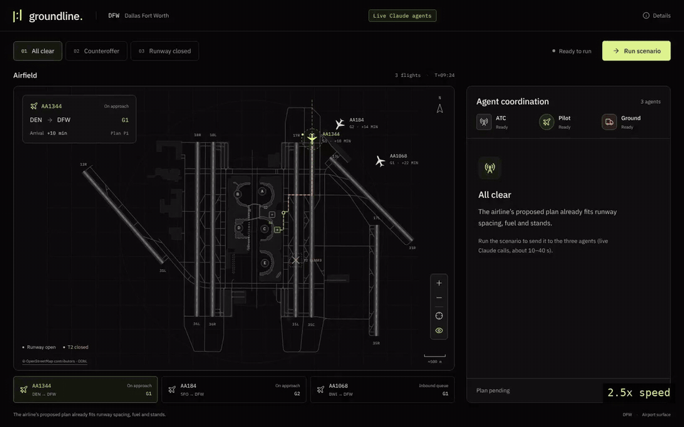

# Groundline: Autonomous SG 2026, Airbus Challenge #2

Three independent Claude agents (ATC, Pilot and Ground) negotiate a flight-disruption
plan in at most two rounds, while Python enforces every safety rule. A deterministic
coordinator picks among complete plans by a fixed policy, never by vote, and returns one
of three outcomes for a human controller: **consensus**, a **checked fallback**, or an
urgent **escalation**. A React dashboard on a DFW airport map runs real agent calls on a
real 2015 DOT delayed flight and shows each agent's reasoning, the checks behind it and a
modelled fuel/CO₂ estimate.



All three scenarios run against live Claude agents on 31 Oct 2026, recorded with
Playwright. Waits for agent replies are shown at 8x and the rest at 2.5x; each
stretch is labelled. Full quality: [sped-up MP4](docs/media/groundline-demo.mp4),
[real-time MP4](docs/media/groundline-demo-realtime.mp4) (2 min 10 s, uncut).

## How it works

| Part | Uses an LLM for | Code is responsible for |
|---|---|---|
| ATC agent | Choosing and explaining among valid plans | Runway windows, wake separation, taxiway blockage, throughput, delay |
| Pilot agent | Choosing and explaining among valid plans | Fuel reserve after holding, turbulence cap, passenger connections |
| Ground agent | Choosing and explaining among valid plans | Stand conflicts, crew availability and overtime, turnaround |
| Coordinator | Nothing | Proposals, reply validation, ranking, deadlines, fallback, evidence log |

Each agent answers ACCEPT, COUNTER (ranked safe alternatives) or REJECT. A vote that
accepts a plan failing its own checks, cites a check that does not exist or is malformed
is rejected in code. Consensus needs all three to accept the same plan plus a final
re-check. Runs are bounded: at most 2 rounds and 6 model calls, no retries, 70 s.
Every result is a recommendation for a controller; nothing is executed.

## Run the demo

You need Python 3.11+ and Node 20.19+ (or 22.12+). Use two terminals, both
starting at the repository root.

**Terminal 1: backend**

```sh
# macOS / Linux
python3 -m venv .venv
.venv/bin/python -m pip install -r requirements.lock
.venv/bin/python -m dev.serve
```

```powershell
# Windows
python -m venv .venv
.venv\Scripts\python -m pip install -r requirements.lock
.venv\Scripts\python -m dev.serve
```

It prints `Backend mode: offline on http://127.0.0.1:8000`.

**Terminal 2: frontend**

```sh
cd frontend
npm ci
npm run dev
```

Open <http://127.0.0.1:5173>, choose a scenario and click **Run scenario**.

Offline mode needs no API key. It runs the real coordinator, domain checks and
agent adapters with a scripted model standing in for Claude, so every outcome
and check is visible at no cost.

**Live Claude agents.** Copy [.env.example](.env.example) to `.env` (git-ignored)
and set `ANTHROPIC_API_KEY`. Restart the backend with `dev.serve --live`. The
header badge changes from **Offline test agents** to **Live Claude agents**, and
a run takes 10 to 40 seconds.

| Scenario | Situation | Outcome |
|---|---|---|
| All clear | The proposed plan already fits runway spacing, fuel and stands | Consensus in round 1 |
| Counteroffer | 2 min arrival gap (3 min required) and a shared stand | Agents counter; coordinator proposes P1; consensus in round 2 (fallback if a live agent times out) |
| Runway closed | Runway closed until +45 min; every plan lands earlier | Escalated: urgent controller alert with fuel deadlines |

All three reached these outcomes with live Claude agents on 31 Oct 2026. Flight identity
is real (CSV row 76); fuel, stands, crews and runway state are simulated and labelled.

## Test

```sh
.venv/bin/python -m pytest -q                    # 206 backend tests
.venv/bin/python scripts/check_alignment.py      # source and requirement checks
cd frontend && npm test && npm run build         # 25 frontend tests and the build
```

On Windows use `.venv\Scripts\python` in place of `.venv/bin/python`.

The alignment check verifies source hashes, schemas, row counts, disruption eligibility,
lookup joins, Markdown links and requirement coverage.

## Project layout

| Path | Contents |
|---|---|
| `agents/`, `domains/` | ATC, Pilot and Ground LLM adapters and their deterministic checkers |
| `runtime/` | Coordinator, model gateway, scenario loader, demo scenarios, event log |
| `contracts/` | Shared protocol 1.0 types |
| `analysis/` | Fuel/CO₂ modelled estimate |
| `api.py`, `api_fuel.py`, `app.py` | FastAPI backend (with fuel panel) and CLI |
| `frontend/` | React + Vite dashboard ([setup](frontend/README.md)) |
| `dev/serve.py` | Starts the backend offline or live |
| `tests/` | Backend test suite |
| `docs/`, `data/raw/`, `references/` | Requirements, design, decisions, source data and the original brief |

## Known limits

Agents choose from a bounded catalog of plans, so an escalation does not prove no
feasible plan exists. Fuel is a holding-only model. The ranking order is a prototype
policy, not an aviation standard. A live agent that exceeds the 25 s per-call limit or
returns malformed JSON ends the run in a safe fallback. See [backend notes](docs/backend.md) and
the [decision log](docs/decision-log.md).

## Start here

| Document | Purpose |
|---|---|
| [AGENTS.md](AGENTS.md) | Persistent project instructions and required decision checks |
| [CLAUDE.md](CLAUDE.md) | Entry point for Claude sessions |
| [Challenge #2 requirements](docs/challenge-2-requirements.md) | Complete selected-challenge requirements with stable IDs |
| [Judging rubric](docs/judging-rubric.md) | Official weights, scoring, strong/weak evidence |
| [Dataset contract](docs/datasets.md) | All three CSV schemas, full-file checks, joins, limits and examples |
| [Multi-agent constraints](docs/multi-agent-design-constraints.md) | Skill alignment and proposed coordination rules |
| [AI orchestration architecture](docs/ai-orchestration-architecture.md) | Protocol 1.0, teammate ownership, shared types, domain tools, integration and failure contracts |
| [Architecture explained simply](docs/architecture-explained.md) | Plain-language breakdown of the three AI agents, Python coordinator, negotiation and fallback |
| [Backend handoff](docs/backend.md) | Run/test instructions, API, integration provenance and verified limits |
| [Frontend review draft](docs/frontend-review.md) | Surface radar, agent review, geography/telemetry limits and verification |
| [Alignment checklist](docs/alignment-checklist.md) | Requirement-to-data-to-proof matrix |
| [Decision log](docs/decision-log.md) | Confirmed context, proposals, assumptions and unresolved questions |
| [Full track brief](docs/airbus-track-brief.md) | Normalized reference for all five challenges |
| [Source register](docs/source-register.md) | Source locations, exact hashes, provenance and conversion limits |

## Included source data

- [Airlines CSV](data/raw/airlines.csv): 14 rows, 2 columns.
- [Airports CSV](data/raw/airports.csv): 322 rows, 7 columns.
- [Flights CSV](data/raw/flights.csv): 358,774 rows, 31 columns.
- [Original challenge brief and rubric](references/airbus-track.pdf).
- [User's Challenge #2 screenshot](references/challenge-2-screenshot.png).

The flight file already satisfies the challenge's disruption predicate on every
row. It has no October rows, cancellations or diversions. Its earlier filtering
history is unknown. It supports replay scenarios; it is not a representative
sample for estimating general delay prevalence or a causal benchmark for fuel
and delay savings. Operational state such as fuel, gates and crew schedules is
absent and must be supplied and labelled separately.

Readable complete lookup tables are available for
[airlines](docs/data/airlines.md) and [airports](docs/data/airports.md).
[Flight examples](docs/data/flight-scenarios.md) preserve selected complete source
rows and identify their original CSV row numbers. The full flights CSV is kept
as the lossless source rather than duplicated into a very large Markdown table.
