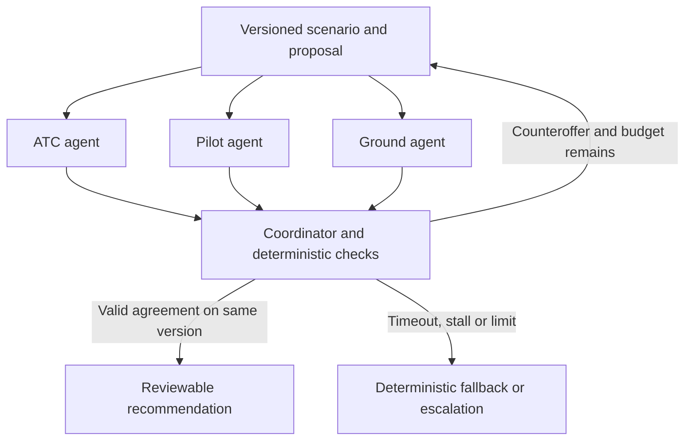

# Multi-agent design constraints

Sources: [Challenge #2 requirements](challenge-2-requirements.md),
[official rubric](judging-rubric.md), [inspected data](datasets.md), and the
user-invoked context-engineering-multi-agent-patterns skill (version 2.1.0;
see [source register](source-register.md)). The following are project design
guardrails and proposals; the skill is not an organizer specification.

## Architecture justification

Use separate domain contexts, tools and objectives for ATC, pilot and ground
(C2-01, C2-04, C2-24). In a tiny scenario, context-window capacity is not the
reason to use three agents. The justification is meaningful independent domain
reasoning and coordination, which the challenge explicitly requests.

| Agent | Relevant context and checks | Required objectives | Data availability |
|---|---|---|---|
| ATC | Candidate slots, wake/separation policy, taxiway blockages | Separation, blockage handling, throughput (C2-09 to C2-11) | Flight history available; live slots, wake classes and taxiways absent |
| Pilot | Aircraft-specific fuel/holding limits, safety restrictions, turbulence exposure, connections | Fuel, safety, turbulence, connections (C2-12 to C2-15) | Flight identity/history available; these operational limits and passenger data absent |
| Ground | Gate occupancy/compatibility, crew shifts and turnaround requirements | Gate use, overtime, turnaround delay (C2-16 to C2-18) | Airport identity available; gate, crew and turn state absent |

Historical row parameters required by C2-21 must reach all three agents through
a traceable shared input envelope. Add domain-specific context separately. Do
not pretend that fuel or gate data is present in the CSVs, and do not withhold
required common row parameters merely to manufacture disagreement.

## Topology (backend implemented; live evaluation pending)

The [protocol 1.0 architecture](ai-orchestration-architecture.md) specifies a
deterministic coordinator plus three LLM domain agents, using direct async Python
interfaces for teammate integration. The coordinator controls state transitions,
routing, deadlines and final validation. Agents exchange structured proposals,
objections and counteroffers through it. Provider/model selection remains open;
an agent framework is optional behind the shared interface.

A swarm or hierarchy would require a concrete benefit that justifies added
coordination within six hours. The skill's preference for direct worker output
is addressed by preserving original domain messages in the interface/log rather
than having a supervisor paraphrase them.

## Protocol guardrails

| ID | Guardrail | Why / requirement |
|---|---|---|
| MA-01 | Separate invocations, role instructions and domain tools; use only relevant context. | Context isolation; C2-01, C2-24 |
| MA-02 | Route validated structured messages with immutable originals and provenance. | Avoid information loss; C2-03, C2-07 |
| MA-03 | Maintain one authoritative scenario/proposal state; coordinator is the writer. | Prevent inconsistent state; C2-05, C2-07 |
| MA-04 | Evaluate the same proposal snapshot independently, optionally in parallel. | Domain evaluation without copying another agent's conclusion; C2-04, C2-06 |
| MA-05 | Check schema, known entity IDs, units, ranges and referenced rule results before sharing an output. | Prevent propagation of invented facts; C2-03, C2-06, C2-26 |
| MA-06 | Hard-constraint failure vetoes a plan. Unanimous agent acceptance is necessary but not sufficient; final code checks must also pass. | C2-26; JR-02, JR-04 |
| MA-07 | Every acceptance identifies the same scenario version, proposal ID and content hash. Any change invalidates old acceptance. | Traceable real consensus; C2-05, C2-07 |
| MA-08 | Configure negotiation limit, wall-clock deadline, output bounds and total retry/call budgets. Repetition without progress triggers termination. | Bounded coordination; C2-23, C2-25 |
| MA-09 | On model failure/timeout/stall/limit, run a deterministic checked fallback. If none is feasible, return explicit escalation. | C2-08, C2-26 |
| MA-10 | Record hard-check results and original proposal/counteroffer events; render explanations from those records. | C2-07; JR-03, JR-04 |
| MA-11 | Label consensus, fallback solution and no-feasible-plan as distinct outcomes. | Avoid false agreement; C2-05, C2-08 |
| MA-12 | Measure calls, tokens, latency, validity and modelled objective outcomes against comparable baselines. | Coordination economics; JR-03, JR-05 |

The earlier message-field suggestions are superseded by the shared models in
[the architecture](ai-orchestration-architecture.md). Use `run_id`, `request_id`,
`role`, scenario version/hash, round/proposal identity, current plan ID/hash and
the structured model decision. Actual rule records and deterministic metrics
remain separate from the model's explanation. These are specified interfaces,
not an implemented API.

Validated source/rule IDs must resolve to actual records; a model citing a rule
does not itself prove that the check ran. Runtime validation should keep immutable
hard limits outside model-editable preferences. Validate and merge counteroffers
before publishing a new proposal; concurrent agents do not mutate shared state.

## Skill adaptations and limits

- Use instruction passing and compact domain snapshots. Do not forward the full
  orchestration transcript into every context. Preserve exact records in shared
  state instead of repeatedly summarizing them.
- A single state owner plus persisted event log is sufficient for the prototype;
  a distributed filesystem or memory service is not a requirement from the skill.
- Confidence-weighted or majority votes cannot override an applicable hard
  constraint. Weights may compare documented soft preferences only after all hard
  checks pass. Require evidence for agreement; do not force artificial dissent.
- A separate LLM verification agent is optional. Deterministic checks are the
  proposed verification boundary, reducing six-hour coordination overhead.
- The skill's 15x token-cost and 50% performance statements are not project
  measurements or universal constants. Log actual usage; do not repeat them as
  measured claims about this system.
- Two complete proposal/evaluation rounds is the current bounded-loop proposal.
  The source's "under 3 turns" remains unresolved. Show both round count and
  individual calls/tool calls/retries; do not conceal overhead in terminology.

## Six-hour scope proposals

One airport, three flights, two gates and one disruption is a proposed starting
scope from earlier discussion. It is not a brief requirement or an implemented
scenario. Every retained role objective still needs a model, labelled assumption
or an explicit coverage gap. A map and animated log are presentation options;
they do not replace constraint checks or evaluation evidence.

The skill guides design; it does not establish feasibility or increase the
earlier 45/60 planning score without implementation/evaluation evidence.
